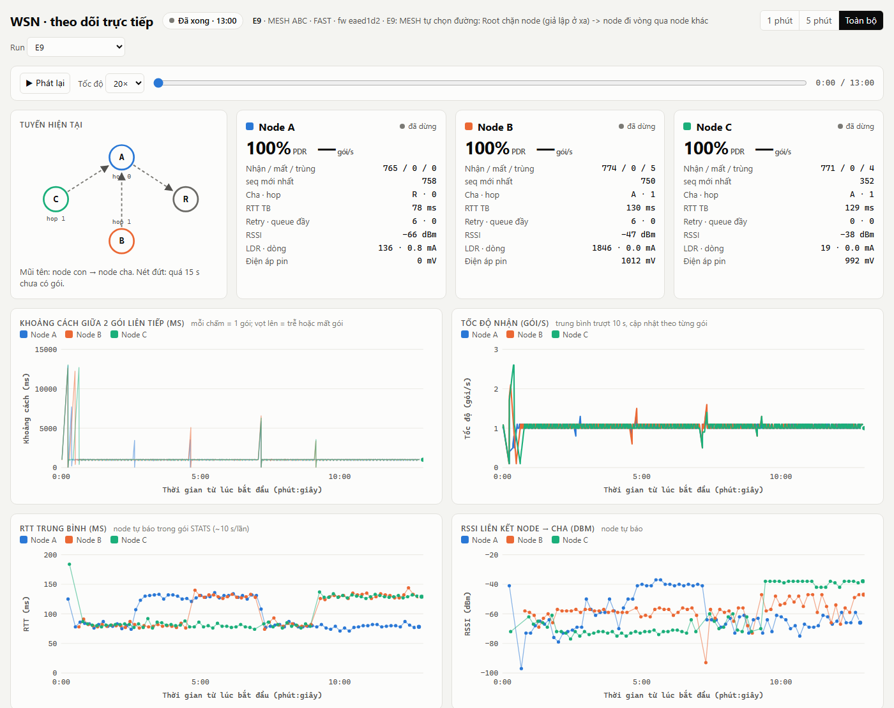
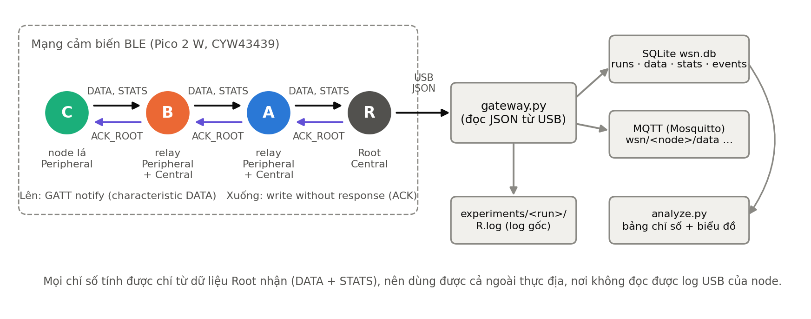
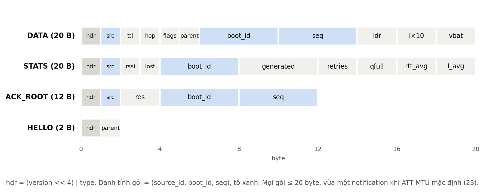
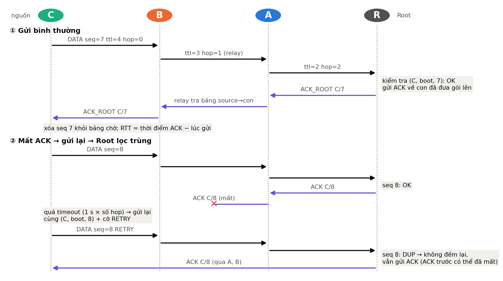
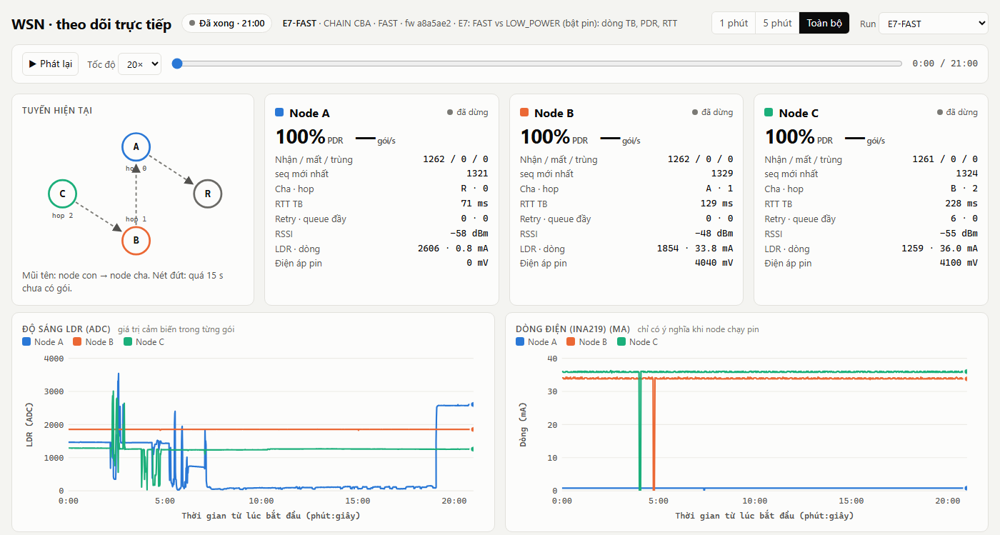
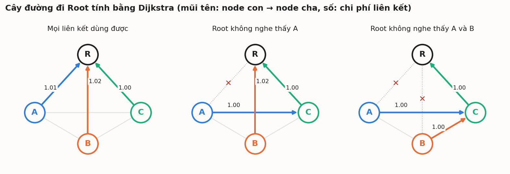
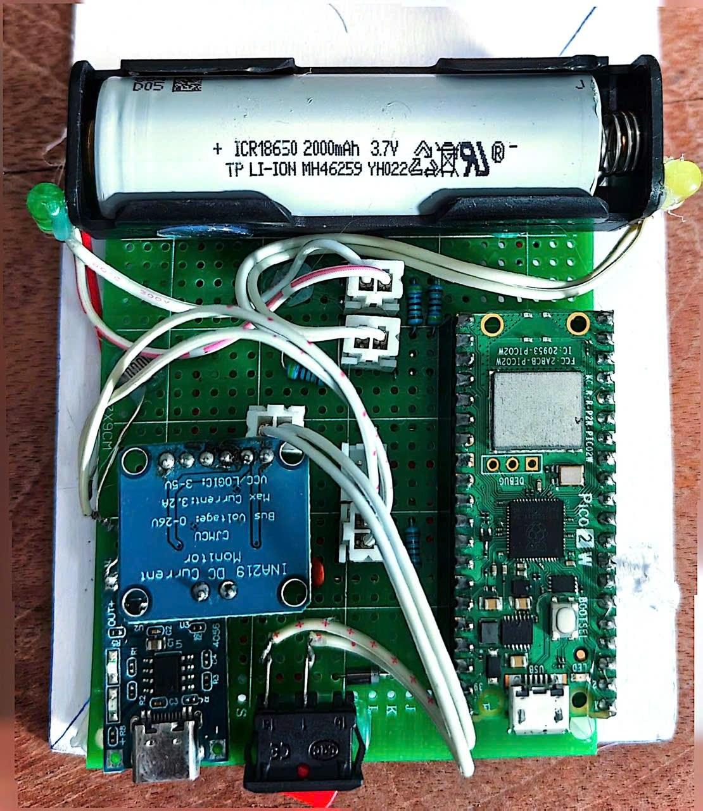
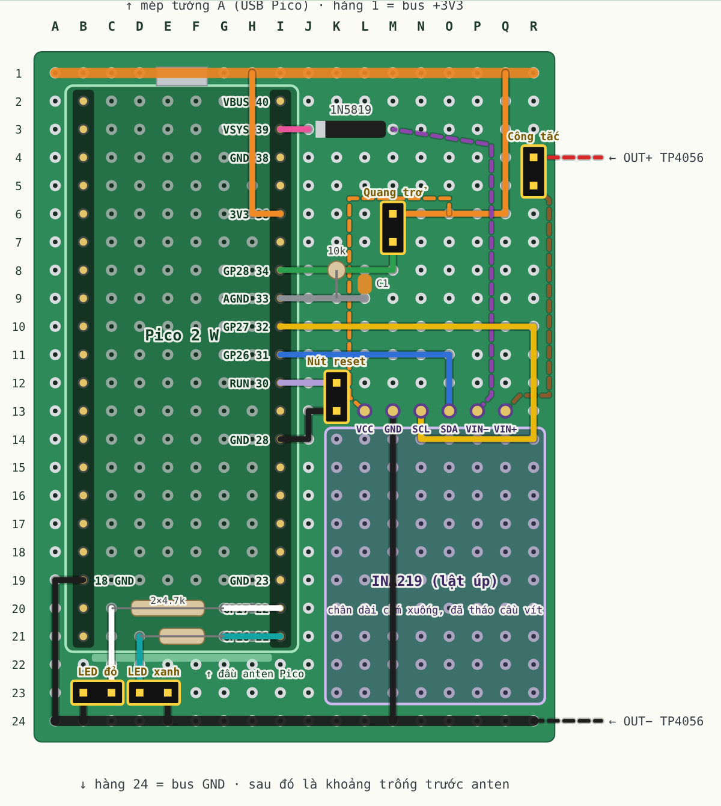

# Multi-hop BLE Wireless Sensor Network on Raspberry Pi Pico 2 W

A four-board wireless sensor network built on Raspberry Pi Pico 2 W (RP2350 + CYW43439) using Bluetooth Low Energy only. Sensor nodes forward data to a Root node over up to three hops, every packet is acknowledged end-to-end by the Root, and nodes find a new route on their own when a link or a parent node disappears.

This is the follow-up to my ESP32 prototype, [ble-sensor-network](https://github.com/menvo-embedded/ble-sensor-network), which had one sensor, one relay and hop-by-hop acknowledgements.



*Real-time dashboard at the end of experiment E9: the Root has been told to ignore B and C, so both now reach it through A.*

## Highlights

- **4 physical boards:** Root + 3 sensor nodes (A, B, C), up to 3 hops (C → B → A → Root).
- **End-to-end reliability:** Root ACK for every packet, retransmission with the same packet identity, duplicate filtering at the Root.
- **Self-healing routing (MESH topology):** nodes choose their parent at runtime, prefer a direct link to the Root, and detour through a neighbour only when the Root cannot hear them. Loop prevention via a path mask in the parent's HELLO.
- **Measured, not assumed:** 23 automated experiment runs, about 8 hours of traffic, 93,825 of 93,844 packets delivered (99.98%). All lost packets came from runs that deliberately injected faults.
- **Real sensing and power data:** LDR light sensor and INA219 current/voltage sensor on each node, battery-powered runs at about 34–36 mA.
- **Tooling:** one-command experiment runner, serial-to-SQLite/MQTT gateway, real-time web dashboard with replay, automatic analysis and figures.
- **Deep-sleep prototype:** wake, sample, broadcast and go back to Pstate sleep. Verified for 100 cycles on hardware with about 1.25 s awake per cycle.

## What changed from the ESP32 version

| | ESP32 prototype | Pico 2 W version (this repo) |
|---|---|---|
| Boards / hops | 3 boards, 1 relay, max 2 hops | 4 boards, any node can relay, up to 3 hops |
| Acknowledgement | Hop-by-hop (GATT Write With Response) | End-to-end: Root ACKs each packet, relays route the ACK back along the learned reverse path |
| Packet identity | `nodeId + seq` (10-byte packet) | `source_id + boot_id + seq` (20-byte packet), so a node reset never looks like a duplicate |
| Failover | Fixed rule: switch to relay after 3 missed ACKs | Parent selection at runtime (MESH), parents release children when they lose the uplink, loop prevention |
| Topologies | Direct or via one relay | PAIR, CHAIN, STAR, DIAMOND, MESH (chosen at build time) |
| Sensor data | Simulated value | LDR + INA219 current and battery voltage |
| Power | Planned | Two BLE power profiles, battery current measured, deep-sleep prototype |
| Stack | Arduino + NimBLE + FreeRTOS tasks | Pico SDK 2.3.1 + BTstack, single event-driven run loop (no blocking calls) |
| Test method | Manual Serial logs | Automated runs, SQLite database, dashboard, scripted fault injection |

## Architecture

```text
 Node C ──BLE──> Node B ──BLE──> Node A ──BLE──> Root ──USB──> gateway.py ──> SQLite (history)
 (leaf)          (relay)         (relay)         (sink)                    └─> MQTT ──> dashboard.py ──> browser
```

- A child node is a BLE **Peripheral / GATT server**: it advertises, and sends DATA and STATS upward as notifications.
- A parent node is a BLE **Central / GATT client**: it scans, connects to children, and writes ACK and HELLO downward.
- A relay runs both roles at the same time on the CYW43439.
- The board's role (R/A/B/C) is selected from the Pico's unique serial number, so one firmware image runs on every board.



### Packet format

Every packet fits in a single BLE notification with the default MTU (20 bytes).

| Packet | Direction | Purpose |
|---|---|---|
| `DATA` | up | Sensor sample, identified by `(source_id, boot_id, seq)`, plus TTL, hop count and current parent |
| `ACK_ROOT` | down | Root confirms one DATA packet (same identity triple) |
| `STATS` | up | Per-node counters: generated, retries, queue full, parent losses, RTT, average current |
| `HELLO` | down | Parent announces its id and the path from itself to the Root (used for hop count and loop prevention) |



### Reliability

- Each node keeps up to 16 packets waiting for an ACK. The ACK timeout is 1 s per hop (FAST profile). A packet is resent with the same identity and a `RETRY` flag, up to 4 transmissions, then counted as dropped.
- Relays learn "source → child" from upward traffic and use it to route ACKs back down.
- The Root filters duplicates (window of the last 64 packets per node) but still ACKs them, so the sender stops retrying.
- When a node gets a new parent, its pending packets are resent immediately instead of waiting for the timeout.



### MESH routing

1. A node without a parent advertises.
2. The Root accepts it immediately. A relay accepts it only after seeing it advertise for 1.5 s without being taken by the Root, so direct links are always preferred.
3. A node that loses its uplink releases all of its children and advertises again.
4. A child rejects a parent whose path to the Root already contains the child itself, which prevents A → B → A loops.

For experiments on a single desk, the Root has a `deny` command that makes it ignore selected nodes, which emulates nodes that are out of range. The radio links and traffic are real; only "out of range" is emulated.

### Power profiles

| Parameter | FAST | LOW_POWER |
|---|---|---|
| Connection interval | 50 ms | 500 ms |
| Peripheral latency | 0 | 3 |
| Supervision timeout | 4 s | 10 s |
| Data period | 1 s | 5 s |

## Results

Experiments ran on four boards on one desk (all links strong). Full numbers are in [experiments/](experiments/README.md).

| Experiment | What it tests | Result |
|---|---|---|
| E1 | Single hop, 30 min; MESH, 2 h | 100% delivery, RTT about 80 ms, 0 retries |
| E2 | Chain of 1–3 hops | RTT 80 / 130 / 181 ms: about **+50 ms per hop**, one connection interval |
| E3 | Relay powered off 3 times | 99.88–99.94% delivery; children back after about 6 s |
| E4 | Root drops 10 / 30 / 50% of ACKs | 100% delivery; every duplicate filtered |
| E5 | Data period 200 / 100 / 50 ms | Queue starts to overflow at 50 ms (60 packets/s network-wide) |
| E6 | Parent of C reset / loses uplink | Reroute in about 5.7 s / 1.9 s |
| E7 | Battery powered, FAST profile | 33.9 mA (relay), 35.9 mA (leaf), 100% delivery |
| E9 | MESH, Root ignores nodes | 6,590/6,590 packets, 23 reroutes (median 4.05 s), no loops |



### Toward lower power

Keeping a BLE connection open costs about 35 mA, which is roughly two days on an 18650 cell. Two pieces of follow-up work are in this repo:

- **Deep-sleep node** (`tools/sleepnode`): the node wakes from RP2350 Pstate, powers the CYW43439, broadcasts its sample as a non-connectable advertisement for 0.3 s, then powers down and sleeps again. On hardware: 100/100 cycles, about 1.25 s awake per cycle (0.9 s of it is radio start-up), wake period accurate to about 1%.
- **Root-computed shortest path:** link costs from measured RSSI and retry rate, then Dijkstra. In the lab it picks the star topology; when the Root cannot hear a node, it detours through the best neighbour.



## Hardware

- 4 × Raspberry Pi Pico 2 W (one Root on USB, three nodes)
- Per node: LDR voltage divider (GP28/ADC2), INA219 current sensor (I2C1 on GP26/GP27, address 0x40), 18650 cell with a TP4056 charger, switch, 1N5819 diode into VSYS
- Wiring diagrams (Vietnamese): [perfboard layout](docs/mach-duc-lo.html), [enclosure wiring](docs/so-do-day-hop-node.html)

| Assembled sensor node | Perfboard layout |
|---|---|
|  |  |

The battery path is TP4056 OUT+ → switch → INA219 VIN+ → VIN− → 1N5819 → VSYS, so the INA219 measures the whole node's current and the diode keeps USB power from back-feeding the cell.

## Repository structure

```text
pico2w-wsn/       Network firmware (C++, Pico SDK + BTstack)
  src/wsn_proto.h     Packet formats
  src/wsn_config.*    Board table, topology and power profiles
  src/wsn_uplink.cpp  Child side: advertise, connect to parent, HELLO / ACK handling
  src/wsn_downlink.cpp Parent side: scan, accept children, relay, ACK routing, MESH adoption
  src/wsn_source.cpp  Sensor sampling, pending queue, retries, STATS
  src/wsn_root.cpp    Root: duplicate filter, ACK, JSON log to USB
gateway/          Serial gateway (SQLite + MQTT), analysis, real-time dashboard
tools/            Build, flash, log capture, experiment runner, diagnostics, deep-sleep prototype
docs/             Firmware guide, experiment guide, sleep study, figures and wiring (Vietnamese)
experiments/      Analysed results of every run (metrics, figures, dashboard screenshots)
```

## Build and run

Requirements: Pico SDK 2.3.1 with toolchain, CMake and Ninja as installed by the official Raspberry Pi Pico VS Code extension (under `~/.pico-sdk`), Python 3 with `pyserial`, `paho-mqtt`, `matplotlib`, and a Mosquitto broker for the live dashboard.

```bash
# Build one configuration: topology, node order, power profile
tools/build.sh MESH ABC FAST          # -> pico2w-wsn/build-MESH-ABC-FAST/pico2w-wsn.uf2
tools/build.sh CHAIN CBA LOW_POWER

# Flash every connected board (role is chosen by the board's serial number)
python tools/flash.py pico2w-wsn/build-MESH-ABC-FAST/pico2w-wsn.uf2

# Run a full experiment: build, flash, log, inject faults on schedule, analyse
python tools/exp.py E9

# Gateway and dashboard on their own
python gateway/gateway.py my-run --minutes 30
python gateway/dashboard.py            # http://localhost:8000
```

Board serial numbers are listed in `tools/boards.py` and `pico2w-wsn/src/wsn_config.cpp`. Replace them with your own boards' serials.

## Limitations

- All experiments so far ran on one desk, where every link is strong. Out-of-range nodes are emulated with `deny`. Field tests at real distances are the next step.
- Battery current was measured on two of the three nodes; the third node's INA219 module has a power fault that is still being repaired.
- The deep-sleep node is a standalone prototype. It is not yet integrated with the routed network, and sleep current has not been measured with a meter.
- The INA219 samples slowly, so it reports average current and misses short radio bursts.

## Development note

As with the ESP32 version, this project used AI-assisted coding for most of the firmware and tooling. My work was defining how the network should behave, building and debugging the hardware (including tracking down wiring faults that only showed up on battery power), designing and running the experiments, and reading the results to decide the next design steps. I keep working through the code so that I can explain and extend every part of it.
